<p align="center">
  
</p>

<h1 align="center">Java Course Grade Calculator</h1>

<p align="center">
  <strong>Make weighted coursework easier to calculate and verify.</strong><br/>
  A Java Swing desktop utility that validates category weights and converts marks into a final percentage, letter grade and GPA.
</p>

<p align="center">
  <a href="https://dev.java/"></a>
  <a href="https://docs.oracle.com/javase/tutorial/uiswing/"></a>
  <a href="LICENSE"></a>
</p>

<p align="center">
  <a href="#project-details">Project details</a> · <a href="#project-setup">Get started</a> · <a href="#creator-developer-maintainer">Creator</a>
</p>

---

<a id="project-details"></a>
## 🚀 Features

* **Weighted Calculations:** Accurately computes final grades based on the percentage weight of different coursework.
* **Input Validation:** Ensures that the total weightage exactly equals 100% before calculating.
* **Instant Conversion:** Automatically converts the final percentage into a Letter Grade and a 4.0 Scale Grade Point.
* **Clean Interface:** Built using `GridBagLayout` for a structured and intuitive user experience.

## 📋 Prerequisites

To run or compile this project, you need:
* [Java Development Kit (JDK) 8 or higher](https://www.oracle.com/java/technologies/downloads/) installed on your machine.
* A Java IDE (like IntelliJ IDEA, Eclipse, or VS Code) or terminal access to compile and run standard Java files.

<a id="project-setup"></a>
## 🛠️ How to Run

**Using the Command Line:**

1. Clone the repository:
   ```bash
   git clone https://github.com/tracolerd/java-course-grade-calculator.git
   ```
2. Navigate to the project directory:
      ```bash
      cd java-course-grade-calculator
      ```
3. The source file is stored as `course_grade_calculator.java`, but its public class is `CourseGradeCalculator`. Java requires those names to match, so rename it before compiling. In PowerShell:
      ```powershell
      Rename-Item .\course_grade_calculator.java CourseGradeCalculator.java
      javac CourseGradeCalculator.java
      ```
4. Run the application:
      ```bash
      java CourseGradeCalculator
      ```

📝 License
This project is licensed under the MIT License - see the LICENSE file for details.

---
---

---

## Creator, Developer & Maintainer

**Created, designed, developed, documented, and maintained independently by [Nurul Faiyaz](https://github.com/tracolerd).**

<p align="center">
  <a href="https://www.facebook.com/faiyaz.888"></a>
  <a href="https://www.instagram.com/tracolerd"></a>
  <a href="https://www.linkedin.com/in/faiyaz-xyz"></a>
  <a href="https://x.com/faiyaz_explores"></a>
  <a href="https://github.com/tracolerd"></a>
  <a href="mailto:scrollfaiyaz@gmail.com"></a>
  <a href="https://nurul-faiyaz.netlify.app/"></a>
</p>

<p align="center">
  <a href="https://www.facebook.com/faiyaz.888">Facebook</a> ·
  <a href="https://www.instagram.com/tracolerd">Instagram</a> ·
  <a href="https://www.linkedin.com/in/faiyaz-xyz">LinkedIn</a> ·
  <a href="https://x.com/faiyaz_explores">X / Twitter</a> ·
  <a href="https://github.com/tracolerd">GitHub</a> ·
  <a href="mailto:scrollfaiyaz@gmail.com">Email</a> ·
  <a href="https://nurul-faiyaz.netlify.app/">Website</a>
</p>

## License

See [LICENSE](LICENSE) for the license terms.
